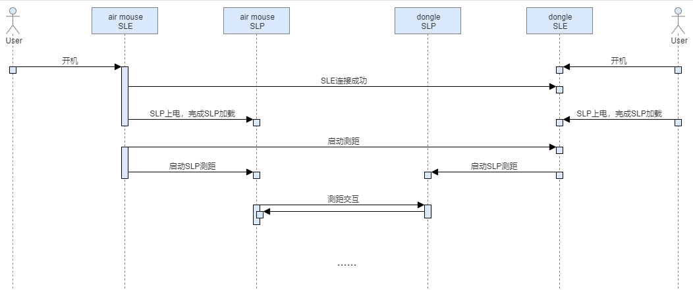

# 前言

**概述**

SP31V100通过API（Application Programming Interfaces）向开发者提供使用SLP的相关接口，本文档详细介绍SLP的API和开发流程。

**产品版本**

与本文档对应的产品版本如下。

<table><thead align="left"><tr id="row761817313520"><th class="cellrowborder" valign="top" width="50%" id="mcps1.1.3.1.1">
<strong id="b138501913165">产品名称</strong>

</th>
<th class="cellrowborder" valign="top" width="50%" id="mcps1.1.3.1.2">
<strong id="b5855151161619">产品版本</strong>

</th>
</tr>
</thead>
<tbody><tr id="row46911211859"><td class="cellrowborder" valign="top" width="50%" headers="mcps1.1.3.1.1 ">
SP31

</td>
<td class="cellrowborder" valign="top" width="50%" headers="mcps1.1.3.1.2 ">
V100

</td>
</tr>
</tbody>
</table>

**读者对象**

本文档主要适用以下工程师：

-   技术支持工程
-   软件开发工程师

**符号约定**

在本文中可能出现下列标志，它们所代表的含义如下。

<table><thead align="left"><tr id="row1530720816410"><th class="cellrowborder" valign="top" width="20.580000000000002%" id="mcps1.1.3.1.1">
<strong id="b2136615816410">符号</strong>

</th>
<th class="cellrowborder" valign="top" width="79.42%" id="mcps1.1.3.1.2">
<strong id="b5941558116410">说明</strong>

</th>
</tr>
</thead>
<tbody><tr id="row1372280416410"><td class="cellrowborder" valign="top" width="20.580000000000002%" headers="mcps1.1.3.1.1 ">

</td>
<td class="cellrowborder" valign="top" width="79.42%" headers="mcps1.1.3.1.2 ">
表示如不避免则将会导致死亡或严重伤害的具有高等级风险的危害。

</td>
</tr>
<tr id="row466863216410"><td class="cellrowborder" valign="top" width="20.580000000000002%" headers="mcps1.1.3.1.1 ">

</td>
<td class="cellrowborder" valign="top" width="79.42%" headers="mcps1.1.3.1.2 ">
表示如不避免则可能导致死亡或严重伤害的具有中等级风险的危害。

</td>
</tr>
<tr id="row123863216410"><td class="cellrowborder" valign="top" width="20.580000000000002%" headers="mcps1.1.3.1.1 ">

</td>
<td class="cellrowborder" valign="top" width="79.42%" headers="mcps1.1.3.1.2 ">
表示如不避免则可能导致轻微或中度伤害的具有低等级风险的危害。

</td>
</tr>
<tr id="row5786682116410"><td class="cellrowborder" valign="top" width="20.580000000000002%" headers="mcps1.1.3.1.1 ">

</td>
<td class="cellrowborder" valign="top" width="79.42%" headers="mcps1.1.3.1.2 ">
用于传递设备或环境安全警示信息。如不避免则可能会导致设备损坏、数据丢失、设备性能降低或其它不可预知的结果。

“须知”不涉及人身伤害。

</td>
</tr>
<tr id="row2856923116410"><td class="cellrowborder" valign="top" width="20.580000000000002%" headers="mcps1.1.3.1.1 ">

</td>
<td class="cellrowborder" valign="top" width="79.42%" headers="mcps1.1.3.1.2 ">
对正文中重点信息的补充说明。

“说明”不是安全警示信息，不涉及人身、设备及环境伤害信息。

</td>
</tr>
</tbody>
</table>

**修改记录**

<table><thead align="left"><tr id="row2942532716410"><th class="cellrowborder" valign="top" width="16.669999999999998%" id="mcps1.1.4.1.1">
<strong id="b5687322716410">文档版本</strong>

</th>
<th class="cellrowborder" valign="top" width="20.45%" id="mcps1.1.4.1.2">
<strong id="b5800814916410">发布日期</strong>

</th>
<th class="cellrowborder" valign="top" width="62.88%" id="mcps1.1.4.1.3">
<strong id="b3316380216410">修改说明</strong>

</th>
</tr>
</thead>
<tbody><tr id="row17316105716403"><td class="cellrowborder" valign="top" width="16.669999999999998%" headers="mcps1.1.4.1.1 ">
03

</td>
<td class="cellrowborder" valign="top" width="20.45%" headers="mcps1.1.4.1.2 ">
2025-06-24

</td>
<td class="cellrowborder" valign="top" width="62.88%" headers="mcps1.1.4.1.3 "><ul id="ul198111454165018"><li>更新“<a href="#ZH-CN_TOPIC_0000001871806213">错误码</a>”小节内容。</li><li>更新“<a href="#ZH-CN_TOPIC_0000001825126684">功能</a>”小节内容。</li><li>新增“<a href="#ZH-CN_TOPIC_0000002317198265">降成本适配</a>”小节内容。</li></ul>
</td>
</tr>
<tr id="row123311731202"><td class="cellrowborder" valign="top" width="16.669999999999998%" headers="mcps1.1.4.1.1 ">
02

</td>
<td class="cellrowborder" valign="top" width="20.45%" headers="mcps1.1.4.1.2 ">
2025-04-23

</td>
<td class="cellrowborder" valign="top" width="62.88%" headers="mcps1.1.4.1.3 "><ul id="ul66551745102215"><li>更新“<a href="#ZH-CN_TOPIC_0000001871806213">错误码</a>”小节内容。</li><li>更新“<a href="#ZH-CN_TOPIC_0000001825126684">功能</a>”小节内容。</li></ul>
</td>
</tr>
<tr id="row16478924125613"><td class="cellrowborder" valign="top" width="16.669999999999998%" headers="mcps1.1.4.1.1 ">
01

</td>
<td class="cellrowborder" valign="top" width="20.45%" headers="mcps1.1.4.1.2 ">
2024-07-29

</td>
<td class="cellrowborder" valign="top" width="62.88%" headers="mcps1.1.4.1.3 ">
第一次正式版本发布。

<ul id="ul68173191655"><li>更新“<a href="#ZH-CN_TOPIC_0000001871806213">错误码</a>”小节内容。</li><li>更新“<a href="#ZH-CN_TOPIC_0000001824966856">SLP接口</a>”小节内容。</li></ul>
</td>
</tr>
<tr id="row81651946131711"><td class="cellrowborder" valign="top" width="16.669999999999998%" headers="mcps1.1.4.1.1 ">
00B01

</td>
<td class="cellrowborder" valign="top" width="20.45%" headers="mcps1.1.4.1.2 ">
2024-07-04

</td>
<td class="cellrowborder" valign="top" width="62.88%" headers="mcps1.1.4.1.3 ">
第一次临时版本发布。

</td>
</tr>
</tbody>
</table>

# 概述

SP31V100通过API（Application Programming Interface）面向开发者提供SLP功能的开发和应用接口。

# 错误码

SLP接口调用完成或SLP业务执行过程中遇到异常会上报错误码，用户可通过错误码排查问题，错误码分为以下三个级别：

INFO：表示接口执行成功；

WARNING：提示类错误；典型的出现场景是状态重复切换；该错误不影响正常功能，可忽略或者用于排查冗余的代码流程；

ERROR：严重错误，可能会导致业务启动失败，需要排查原因避免此类错误的出现。

**表 1**  SLP错误码（ErrcodeSlpClient）

<table><thead align="left"><tr id="row469mcpsimp"><th class="cellrowborder" valign="top" width="6.831366273254649%" id="mcps1.2.7.1.1">
序号

</th>
<th class="cellrowborder" valign="top" width="26.0252050410082%" id="mcps1.2.7.1.2">
定义

</th>
<th class="cellrowborder" valign="top" width="12.97259451890378%" id="mcps1.2.7.1.3">
实际数值

</th>
<th class="cellrowborder" valign="top" width="20.61412282456491%" id="mcps1.2.7.1.4">
描述

</th>
<th class="cellrowborder" valign="top" width="26.035207041408277%" id="mcps1.2.7.1.5">
常见产生原因

</th>
<th class="cellrowborder" valign="top" width="7.521504300860171%" id="mcps1.2.7.1.6">
级别

</th>
</tr>
</thead>
<tbody><tr id="row1157925823317"><td class="cellrowborder" valign="top" width="6.831366273254649%" headers="mcps1.2.7.1.1 ">
1

</td>
<td class="cellrowborder" valign="top" width="26.0252050410082%" headers="mcps1.2.7.1.2 ">
ERRCODE_SLPC_SUCCESS

</td>
<td class="cellrowborder" valign="top" width="12.97259451890378%" headers="mcps1.2.7.1.3 ">
0

</td>
<td class="cellrowborder" valign="top" width="20.61412282456491%" headers="mcps1.2.7.1.4 ">
执行成功

</td>
<td class="cellrowborder" valign="top" width="26.035207041408277%" headers="mcps1.2.7.1.5 ">
正常执行

</td>
<td class="cellrowborder" valign="top" width="7.521504300860171%" headers="mcps1.2.7.1.6 ">
INFO

</td>
</tr>
<tr id="row1579165811336"><td class="cellrowborder" valign="top" width="6.831366273254649%" headers="mcps1.2.7.1.1 ">
2

</td>
<td class="cellrowborder" valign="top" width="26.0252050410082%" headers="mcps1.2.7.1.2 ">
ERRCODE_SLPC_MALLOC_FAILED

</td>
<td class="cellrowborder" valign="top" width="12.97259451890378%" headers="mcps1.2.7.1.3 ">
0x80009600

</td>
<td class="cellrowborder" valign="top" width="20.61412282456491%" headers="mcps1.2.7.1.4 ">
申请动态内存失败错误码

</td>
<td class="cellrowborder" valign="top" width="26.035207041408277%" headers="mcps1.2.7.1.5 ">
内存不足，或者内存申请过程出现异常

</td>
<td class="cellrowborder" valign="top" width="7.521504300860171%" headers="mcps1.2.7.1.6 ">
ERROR

</td>
</tr>
<tr id="row13579175810332"><td class="cellrowborder" valign="top" width="6.831366273254649%" headers="mcps1.2.7.1.1 ">
3

</td>
<td class="cellrowborder" valign="top" width="26.0252050410082%" headers="mcps1.2.7.1.2 ">
ERRCODE_SLPC_MEMCPY_FAILED

</td>
<td class="cellrowborder" valign="top" width="12.97259451890378%" headers="mcps1.2.7.1.3 ">
0x80009601

</td>
<td class="cellrowborder" valign="top" width="20.61412282456491%" headers="mcps1.2.7.1.4 ">
内存拷贝失败错误码

</td>
<td class="cellrowborder" valign="top" width="26.035207041408277%" headers="mcps1.2.7.1.5 ">
内存拷贝过程异常

</td>
<td class="cellrowborder" valign="top" width="7.521504300860171%" headers="mcps1.2.7.1.6 ">
ERROR

</td>
</tr>
<tr id="row17579185893319"><td class="cellrowborder" valign="top" width="6.831366273254649%" headers="mcps1.2.7.1.1 ">
4

</td>
<td class="cellrowborder" valign="top" width="26.0252050410082%" headers="mcps1.2.7.1.2 ">
ERRCODE_SLPC_SEND_PAYLOAD_FAILED

</td>
<td class="cellrowborder" valign="top" width="12.97259451890378%" headers="mcps1.2.7.1.3 ">
0x80009602

</td>
<td class="cellrowborder" valign="top" width="20.61412282456491%" headers="mcps1.2.7.1.4 ">
发送负载失败错误码

</td>
<td class="cellrowborder" valign="top" width="26.035207041408277%" headers="mcps1.2.7.1.5 ">
没有注册发送函数接口

</td>
<td class="cellrowborder" valign="top" width="7.521504300860171%" headers="mcps1.2.7.1.6 ">
ERROR

</td>
</tr>
<tr id="row1457915583333"><td class="cellrowborder" valign="top" width="6.831366273254649%" headers="mcps1.2.7.1.1 ">
5

</td>
<td class="cellrowborder" valign="top" width="26.0252050410082%" headers="mcps1.2.7.1.2 ">
ERRCODE_SLPC_RECV_PAYLOAD_FAILED

</td>
<td class="cellrowborder" valign="top" width="12.97259451890378%" headers="mcps1.2.7.1.3 ">
0x80009603

</td>
<td class="cellrowborder" valign="top" width="20.61412282456491%" headers="mcps1.2.7.1.4 ">
接收负载失败错误码

</td>
<td class="cellrowborder" valign="top" width="26.035207041408277%" headers="mcps1.2.7.1.5 ">
检测到一段时间没有收到测量值消息的时候会上报该错误码，此时业务内部会执行重启测距流程进行自恢复。若周期性的上报该错误码表示流程业务异常，无法恢复，需要排查原因，如：窄带通信流程异常、对端slp加载失败等

</td>
<td class="cellrowborder" valign="top" width="7.521504300860171%" headers="mcps1.2.7.1.6 ">
WARNING/ERROR

</td>
</tr>
<tr id="row3579135816330"><td class="cellrowborder" valign="top" width="6.831366273254649%" headers="mcps1.2.7.1.1 ">
6

</td>
<td class="cellrowborder" valign="top" width="26.0252050410082%" headers="mcps1.2.7.1.2 ">
ERRCODE_SLPC_POWER_ON_FAILED

</td>
<td class="cellrowborder" valign="top" width="12.97259451890378%" headers="mcps1.2.7.1.3 ">
0x80009604

</td>
<td class="cellrowborder" valign="top" width="20.61412282456491%" headers="mcps1.2.7.1.4 ">
上电加载失败错误码

</td>
<td class="cellrowborder" valign="top" width="26.035207041408277%" headers="mcps1.2.7.1.5 ">
上电加载过程出现异常

</td>
<td class="cellrowborder" valign="top" width="7.521504300860171%" headers="mcps1.2.7.1.6 ">
ERROR

</td>
</tr>
<tr id="row657995810337"><td class="cellrowborder" valign="top" width="6.831366273254649%" headers="mcps1.2.7.1.1 ">
7

</td>
<td class="cellrowborder" valign="top" width="26.0252050410082%" headers="mcps1.2.7.1.2 ">
ERRCODE_SLPC_POWERD_ON

</td>
<td class="cellrowborder" valign="top" width="12.97259451890378%" headers="mcps1.2.7.1.3 ">
0x80009605

</td>
<td class="cellrowborder" valign="top" width="20.61412282456491%" headers="mcps1.2.7.1.4 ">
SLP已经上电加载错误码

</td>
<td class="cellrowborder" valign="top" width="26.035207041408277%" headers="mcps1.2.7.1.5 ">
SLP已经上电，又收到了上电命令

</td>
<td class="cellrowborder" valign="top" width="7.521504300860171%" headers="mcps1.2.7.1.6 ">
WARNGING

</td>
</tr>
<tr id="row2057935816331"><td class="cellrowborder" valign="top" width="6.831366273254649%" headers="mcps1.2.7.1.1 ">
8

</td>
<td class="cellrowborder" valign="top" width="26.0252050410082%" headers="mcps1.2.7.1.2 ">
ERRCODE_SLPC_INCORRECT_PARAM

</td>
<td class="cellrowborder" valign="top" width="12.97259451890378%" headers="mcps1.2.7.1.3 ">
0x80009606

</td>
<td class="cellrowborder" valign="top" width="20.61412282456491%" headers="mcps1.2.7.1.4 ">
参数设置失败错误码

</td>
<td class="cellrowborder" valign="top" width="26.035207041408277%" headers="mcps1.2.7.1.5 ">
测距启动命令里的参数/本机属性参数 设置不正确

</td>
<td class="cellrowborder" valign="top" width="7.521504300860171%" headers="mcps1.2.7.1.6 ">
ERROR

</td>
</tr>
<tr id="row25791558163316"><td class="cellrowborder" valign="top" width="6.831366273254649%" headers="mcps1.2.7.1.1 ">
9

</td>
<td class="cellrowborder" valign="top" width="26.0252050410082%" headers="mcps1.2.7.1.2 ">
ERRCODE_GET_SESSION_KEY_FAILED

</td>
<td class="cellrowborder" valign="top" width="12.97259451890378%" headers="mcps1.2.7.1.3 ">
0x80009607

</td>
<td class="cellrowborder" valign="top" width="20.61412282456491%" headers="mcps1.2.7.1.4 ">
会话密钥获取失败错误码

</td>
<td class="cellrowborder" valign="top" width="26.035207041408277%" headers="mcps1.2.7.1.5 ">
没有从窄带获取到会话密钥

</td>
<td class="cellrowborder" valign="top" width="7.521504300860171%" headers="mcps1.2.7.1.6 ">
ERROR

</td>
</tr>
<tr id="row1757915585330"><td class="cellrowborder" valign="top" width="6.831366273254649%" headers="mcps1.2.7.1.1 ">
10

</td>
<td class="cellrowborder" valign="top" width="26.0252050410082%" headers="mcps1.2.7.1.2 ">
ERRCODE_SLPC_QUEUE_WRITE_FAILED

</td>
<td class="cellrowborder" valign="top" width="12.97259451890378%" headers="mcps1.2.7.1.3 ">
0x80009608

</td>
<td class="cellrowborder" valign="top" width="20.61412282456491%" headers="mcps1.2.7.1.4 ">
消息队列写入失败错误码

</td>
<td class="cellrowborder" valign="top" width="26.035207041408277%" headers="mcps1.2.7.1.5 ">
消息队列已满，再次写入会失败

</td>
<td class="cellrowborder" valign="top" width="7.521504300860171%" headers="mcps1.2.7.1.6 ">
ERROR

</td>
</tr>
<tr id="row45791258193319"><td class="cellrowborder" valign="top" width="6.831366273254649%" headers="mcps1.2.7.1.1 ">
11

</td>
<td class="cellrowborder" valign="top" width="26.0252050410082%" headers="mcps1.2.7.1.2 ">
ERRCODE_SLPC_START_RANGING_FAILED

</td>
<td class="cellrowborder" valign="top" width="12.97259451890378%" headers="mcps1.2.7.1.3 ">
0x80009609

</td>
<td class="cellrowborder" valign="top" width="20.61412282456491%" headers="mcps1.2.7.1.4 ">
启动测距失败错误码

</td>
<td class="cellrowborder" valign="top" width="26.035207041408277%" headers="mcps1.2.7.1.5 ">
SLP还没上电时，发送了测距启动命令，

或者切换窄带时钟失败

</td>
<td class="cellrowborder" valign="top" width="7.521504300860171%" headers="mcps1.2.7.1.6 ">
ERROR

</td>
</tr>
<tr id="row057955820338"><td class="cellrowborder" valign="top" width="6.831366273254649%" headers="mcps1.2.7.1.1 ">
12

</td>
<td class="cellrowborder" valign="top" width="26.0252050410082%" headers="mcps1.2.7.1.2 ">
ERRCODE_SLPC_SET_LOCAL_ATT_FAILED

</td>
<td class="cellrowborder" valign="top" width="12.97259451890378%" headers="mcps1.2.7.1.3 ">
0x8000960A

</td>
<td class="cellrowborder" valign="top" width="20.61412282456491%" headers="mcps1.2.7.1.4 ">
设置本机属性失败错误码

</td>
<td class="cellrowborder" valign="top" width="26.035207041408277%" headers="mcps1.2.7.1.5 ">
设置本机属性的消息为空消息

</td>
<td class="cellrowborder" valign="top" width="7.521504300860171%" headers="mcps1.2.7.1.6 ">
ERROR

</td>
</tr>
<tr id="row6579125812339"><td class="cellrowborder" valign="top" width="6.831366273254649%" headers="mcps1.2.7.1.1 ">
13

</td>
<td class="cellrowborder" valign="top" width="26.0252050410082%" headers="mcps1.2.7.1.2 ">
ERRCODE_SLPC_ALREADY_IN_RANGING

</td>
<td class="cellrowborder" valign="top" width="12.97259451890378%" headers="mcps1.2.7.1.3 ">
0x8000960B

</td>
<td class="cellrowborder" valign="top" width="20.61412282456491%" headers="mcps1.2.7.1.4 ">
已经在测距中错误码

</td>
<td class="cellrowborder" valign="top" width="26.035207041408277%" headers="mcps1.2.7.1.5 ">
已经启动测距了，又收到了测距启动命令

</td>
<td class="cellrowborder" valign="top" width="7.521504300860171%" headers="mcps1.2.7.1.6 ">
WARNGING

</td>
</tr>
<tr id="row1957855813315"><td class="cellrowborder" valign="top" width="6.831366273254649%" headers="mcps1.2.7.1.1 ">
14

</td>
<td class="cellrowborder" valign="top" width="26.0252050410082%" headers="mcps1.2.7.1.2 ">
ERRCODE_SLPC_ALREADY_STOP_RANGING

</td>
<td class="cellrowborder" valign="top" width="12.97259451890378%" headers="mcps1.2.7.1.3 ">
0x8000960C

</td>
<td class="cellrowborder" valign="top" width="20.61412282456491%" headers="mcps1.2.7.1.4 ">
已经停止测距错误码

</td>
<td class="cellrowborder" valign="top" width="26.035207041408277%" headers="mcps1.2.7.1.5 ">
测距已经停止了，又收到了停止测距的命令

</td>
<td class="cellrowborder" valign="top" width="7.521504300860171%" headers="mcps1.2.7.1.6 ">
WARNGING

</td>
</tr>
<tr id="row125781758143310"><td class="cellrowborder" valign="top" width="6.831366273254649%" headers="mcps1.2.7.1.1 ">
15

</td>
<td class="cellrowborder" valign="top" width="26.0252050410082%" headers="mcps1.2.7.1.2 ">
ERRCODE_SLPC_ALREADY_PAUSE_RANGING

</td>
<td class="cellrowborder" valign="top" width="12.97259451890378%" headers="mcps1.2.7.1.3 ">
0x8000960D

</td>
<td class="cellrowborder" valign="top" width="20.61412282456491%" headers="mcps1.2.7.1.4 ">
已经暂停测距错误码

</td>
<td class="cellrowborder" valign="top" width="26.035207041408277%" headers="mcps1.2.7.1.5 ">
测距已经暂停了，又收到了暂停测距的命令

</td>
<td class="cellrowborder" valign="top" width="7.521504300860171%" headers="mcps1.2.7.1.6 ">
WARNGING

</td>
</tr>
<tr id="row1857814583337"><td class="cellrowborder" valign="top" width="6.831366273254649%" headers="mcps1.2.7.1.1 ">
16

</td>
<td class="cellrowborder" valign="top" width="26.0252050410082%" headers="mcps1.2.7.1.2 ">
ERRCODE_SLPC_ALREADY_SLEEP

</td>
<td class="cellrowborder" valign="top" width="12.97259451890378%" headers="mcps1.2.7.1.3 ">
0x8000960E

</td>
<td class="cellrowborder" valign="top" width="20.61412282456491%" headers="mcps1.2.7.1.4 ">
已经在睡眠中错误码

</td>
<td class="cellrowborder" valign="top" width="26.035207041408277%" headers="mcps1.2.7.1.5 ">
已经睡眠了，又收到了睡眠的命令

</td>
<td class="cellrowborder" valign="top" width="7.521504300860171%" headers="mcps1.2.7.1.6 ">
WARNGING

</td>
</tr>
<tr id="row957813585332"><td class="cellrowborder" valign="top" width="6.831366273254649%" headers="mcps1.2.7.1.1 ">
17

</td>
<td class="cellrowborder" valign="top" width="26.0252050410082%" headers="mcps1.2.7.1.2 ">
ERRCODE_SLPC_STATE_ERROR

</td>
<td class="cellrowborder" valign="top" width="12.97259451890378%" headers="mcps1.2.7.1.3 ">
0x8000960F

</td>
<td class="cellrowborder" valign="top" width="20.61412282456491%" headers="mcps1.2.7.1.4 ">
slp状态错误错误码

</td>
<td class="cellrowborder" valign="top" width="26.035207041408277%" headers="mcps1.2.7.1.5 ">
在收到继续测距命令时，测距状态不是暂停测距

</td>
<td class="cellrowborder" valign="top" width="7.521504300860171%" headers="mcps1.2.7.1.6 ">
WARNGING

</td>
</tr>
<tr id="row1057813586336"><td class="cellrowborder" valign="top" width="6.831366273254649%" headers="mcps1.2.7.1.1 ">
18

</td>
<td class="cellrowborder" valign="top" width="26.0252050410082%" headers="mcps1.2.7.1.2 ">
ERRCODE_SLPC_LOCAL_IMU_READ_DATA

</td>
<td class="cellrowborder" valign="top" width="12.97259451890378%" headers="mcps1.2.7.1.3 ">
0x80009610

</td>
<td class="cellrowborder" valign="top" width="20.61412282456491%" headers="mcps1.2.7.1.4 ">
本端imu读数据异常错误码

</td>
<td class="cellrowborder" valign="top" width="26.035207041408277%" headers="mcps1.2.7.1.5 ">
本端IMU读数异常

</td>
<td class="cellrowborder" valign="top" width="7.521504300860171%" headers="mcps1.2.7.1.6 ">
ERROR

</td>
</tr>
<tr id="row4436919124013"><td class="cellrowborder" valign="top" width="6.831366273254649%" headers="mcps1.2.7.1.1 ">
19

</td>
<td class="cellrowborder" valign="top" width="26.0252050410082%" headers="mcps1.2.7.1.2 ">
ERRCODE_SLPC_PEER_IMU_READ_DATA

</td>
<td class="cellrowborder" valign="top" width="12.97259451890378%" headers="mcps1.2.7.1.3 ">
0x80009611

</td>
<td class="cellrowborder" valign="top" width="20.61412282456491%" headers="mcps1.2.7.1.4 ">
对端imu读数据异常错误码

</td>
<td class="cellrowborder" valign="top" width="26.035207041408277%" headers="mcps1.2.7.1.5 ">
对端IMU读数异常

</td>
<td class="cellrowborder" valign="top" width="7.521504300860171%" headers="mcps1.2.7.1.6 ">
ERROR

</td>
</tr>
<tr id="row1057810586335"><td class="cellrowborder" valign="top" width="6.831366273254649%" headers="mcps1.2.7.1.1 ">
20

</td>
<td class="cellrowborder" valign="top" width="26.0252050410082%" headers="mcps1.2.7.1.2 ">
ERRCODE_SLPC_POWERING_ON

</td>
<td class="cellrowborder" valign="top" width="12.97259451890378%" headers="mcps1.2.7.1.3 ">
0x80009612

</td>
<td class="cellrowborder" valign="top" width="20.61412282456491%" headers="mcps1.2.7.1.4 ">
SLP正在上电中错误码

</td>
<td class="cellrowborder" valign="top" width="26.035207041408277%" headers="mcps1.2.7.1.5 ">
SLP正在上电加载中，又收到了上电命令

</td>
<td class="cellrowborder" valign="top" width="7.521504300860171%" headers="mcps1.2.7.1.6 ">
WARNGING

</td>
</tr>
<tr id="row1357885823312"><td class="cellrowborder" valign="top" width="6.831366273254649%" headers="mcps1.2.7.1.1 ">
21

</td>
<td class="cellrowborder" valign="top" width="26.0252050410082%" headers="mcps1.2.7.1.2 ">
ERRCODE_SLPC_POWERING_OFF

</td>
<td class="cellrowborder" valign="top" width="12.97259451890378%" headers="mcps1.2.7.1.3 ">
0x80009613

</td>
<td class="cellrowborder" valign="top" width="20.61412282456491%" headers="mcps1.2.7.1.4 ">
SLP在下电中错误码

</td>
<td class="cellrowborder" valign="top" width="26.035207041408277%" headers="mcps1.2.7.1.5 ">
SLP正在下电中，又收到了下电命令

</td>
<td class="cellrowborder" valign="top" width="7.521504300860171%" headers="mcps1.2.7.1.6 ">
WARNGING

</td>
</tr>
<tr id="row1757845883310"><td class="cellrowborder" valign="top" width="6.831366273254649%" headers="mcps1.2.7.1.1 ">
22

</td>
<td class="cellrowborder" valign="top" width="26.0252050410082%" headers="mcps1.2.7.1.2 ">
ERRCODE_SLPC_POWERD_OFF

</td>
<td class="cellrowborder" valign="top" width="12.97259451890378%" headers="mcps1.2.7.1.3 ">
0x80009614

</td>
<td class="cellrowborder" valign="top" width="20.61412282456491%" headers="mcps1.2.7.1.4 ">
SLP已经下电错误码

</td>
<td class="cellrowborder" valign="top" width="26.035207041408277%" headers="mcps1.2.7.1.5 ">
SLP已下电， 又收到了下电命令

</td>
<td class="cellrowborder" valign="top" width="7.521504300860171%" headers="mcps1.2.7.1.6 ">
WARNGING

</td>
</tr>
<tr id="row12578185833315"><td class="cellrowborder" valign="top" width="6.831366273254649%" headers="mcps1.2.7.1.1 ">
23

</td>
<td class="cellrowborder" valign="top" width="26.0252050410082%" headers="mcps1.2.7.1.2 ">
ERRCODE_SLPC_MAX

</td>
<td class="cellrowborder" valign="top" width="12.97259451890378%" headers="mcps1.2.7.1.3 ">
0x800097FF

</td>
<td class="cellrowborder" valign="top" width="20.61412282456491%" headers="mcps1.2.7.1.4 ">
SLP错误码最大值

</td>
<td class="cellrowborder" valign="top" width="26.035207041408277%" headers="mcps1.2.7.1.5 ">&nbsp;&nbsp;</td>
<td class="cellrowborder" valign="top" width="7.521504300860171%" headers="mcps1.2.7.1.6 ">
-

</td>
</tr>
</tbody>
</table>

# SLP接口

-   **[功能](#ZH-CN_TOPIC_0000001825126684)**  

-   **[RF Switch配置](#ZH-CN_TOPIC_0000002318237301)**  

-   **[开发流程](#ZH-CN_TOPIC_0000001871686409)**  

## 功能

**表 1**  SLP接口描述

<table><thead align="left"><tr id="row533mcpsimp"><th class="cellrowborder" valign="top" width="24.33%" id="mcps1.2.5.1.1">
接口名称

</th>
<th class="cellrowborder" valign="top" width="28.07%" id="mcps1.2.5.1.2">
描述

</th>
<th class="cellrowborder" valign="top" width="32.58%" id="mcps1.2.5.1.3">
参数说明

</th>
<th class="cellrowborder" valign="top" width="15.02%" id="mcps1.2.5.1.4">
返回信息说明

</th>
</tr>
</thead>
<tbody><tr id="row542mcpsimp"><td class="cellrowborder" valign="top" width="24.33%" headers="mcps1.2.5.1.1 ">
SlpTask

</td>
<td class="cellrowborder" valign="top" width="28.07%" headers="mcps1.2.5.1.2 ">
SLP线程主函数

</td>
<td class="cellrowborder" valign="top" width="32.58%" headers="mcps1.2.5.1.3 ">
-

</td>
<td class="cellrowborder" valign="top" width="15.02%" headers="mcps1.2.5.1.4 ">
-

</td>
</tr>
<tr id="row551mcpsimp"><td class="cellrowborder" valign="top" width="24.33%" headers="mcps1.2.5.1.1 ">
SlpPowerOnCommand

</td>
<td class="cellrowborder" valign="top" width="28.07%" headers="mcps1.2.5.1.2 ">
SLP上电命令，完成SLP加载

</td>
<td class="cellrowborder" valign="top" width="32.58%" headers="mcps1.2.5.1.3 ">
-

</td>
<td class="cellrowborder" valign="top" width="15.02%" headers="mcps1.2.5.1.4 ">
错误码

</td>
</tr>
<tr id="row560mcpsimp"><td class="cellrowborder" valign="top" width="24.33%" headers="mcps1.2.5.1.1 ">
SlpStartRangingCommand

</td>
<td class="cellrowborder" valign="top" width="28.07%" headers="mcps1.2.5.1.2 ">
SLP启动测距命令

</td>
<td class="cellrowborder" valign="top" width="32.58%" headers="mcps1.2.5.1.3 ">
codeLen：前导码长度；

syncCodeIdx：sync段的码字索引值；

syncSymNum：sync段的符号数量；

ctsSegNum：cts域中segment段的数量；

ctsSegSymNum：一个segment段中的符号数量；

gapBaseSymNum：gap段基准的符号数量；

ctsCpLen：cts段中cp长度；

secMode：安全模式；

encryptMode：加密模式；

sessionKeyMode：会话密钥模式；

sessionKeyIdx：会话密钥索引值，会话密钥模式是宽带共享密钥时有效，取值范围0~15；

chIdx：通道号；

usageMode：SLP使用模式；

slpRangingMode：SLP测距模式；

multiNodeMode：SLP多节点模式；

rangingRoundUsage：SLP测距轮用法；

mrSource：slp测量值请求源；

rangingFreq：测距频率，最高频率100Hz，遥控器场景取值：1~20Hz；

validRoundNum：有效测距轮数，取值范围：0~255，其中0表示无限轮；

aoxDirection：测角方向；

firstAoxAntDis：第一测角帧天线间距 单位：nm；

nbSyncMode：窄带同步模式；

deviceNum：参与测距的设备个数，取值：2；

sessionId：会话标识符，随机值，每次启动测距，值不同；

txPower：TX功率码字；

deviceAddr：设备地址列表，第1个是测距发起者的地址。

</td>
<td class="cellrowborder" valign="top" width="15.02%" headers="mcps1.2.5.1.4 ">
错误码

</td>
</tr>
<tr id="row13570105742310"><td class="cellrowborder" valign="top" width="24.33%" headers="mcps1.2.5.1.1 ">
SlpStopRangingCommand

</td>
<td class="cellrowborder" valign="top" width="28.07%" headers="mcps1.2.5.1.2 ">
SLP停止测距：SLP不工作

</td>
<td class="cellrowborder" valign="top" width="32.58%" headers="mcps1.2.5.1.3 ">
-

</td>
<td class="cellrowborder" valign="top" width="15.02%" headers="mcps1.2.5.1.4 ">
错误码

</td>
</tr>
<tr id="row845314243115"><td class="cellrowborder" valign="top" width="24.33%" headers="mcps1.2.5.1.1 ">
SlpPauseRangingCommand

</td>
<td class="cellrowborder" valign="top" width="28.07%" headers="mcps1.2.5.1.2 ">
SLP暂停测距：宽窄带的通信关闭

</td>
<td class="cellrowborder" valign="top" width="32.58%" headers="mcps1.2.5.1.3 ">
-

</td>
<td class="cellrowborder" valign="top" width="15.02%" headers="mcps1.2.5.1.4 ">
错误码

</td>
</tr>
<tr id="row19191115743013"><td class="cellrowborder" valign="top" width="24.33%" headers="mcps1.2.5.1.1 ">
SlpContinueRangingCommand

</td>
<td class="cellrowborder" valign="top" width="28.07%" headers="mcps1.2.5.1.2 ">
SLP继续测距：宽窄带通信恢复

</td>
<td class="cellrowborder" valign="top" width="32.58%" headers="mcps1.2.5.1.3 ">
-

</td>
<td class="cellrowborder" valign="top" width="15.02%" headers="mcps1.2.5.1.4 ">
错误码

</td>
</tr>
<tr id="row588mcpsimp"><td class="cellrowborder" valign="top" width="24.33%" headers="mcps1.2.5.1.1 ">
SlpPowerOffCommand

</td>
<td class="cellrowborder" valign="top" width="28.07%" headers="mcps1.2.5.1.2 ">
SLP下电

</td>
<td class="cellrowborder" valign="top" width="32.58%" headers="mcps1.2.5.1.3 ">
-

</td>
<td class="cellrowborder" valign="top" width="15.02%" headers="mcps1.2.5.1.4 ">
错误码

</td>
</tr>
<tr id="row597mcpsimp"><td class="cellrowborder" valign="top" width="24.33%" headers="mcps1.2.5.1.1 ">
SlpSleepCommand

</td>
<td class="cellrowborder" valign="top" width="28.07%" headers="mcps1.2.5.1.2 ">
SLP睡眠

</td>
<td class="cellrowborder" valign="top" width="32.58%" headers="mcps1.2.5.1.3 ">
-

</td>
<td class="cellrowborder" valign="top" width="15.02%" headers="mcps1.2.5.1.4 ">
错误码

</td>
</tr>
<tr id="row606mcpsimp"><td class="cellrowborder" valign="top" width="24.33%" headers="mcps1.2.5.1.1 ">
SlpSetLocalAttCommand

</td>
<td class="cellrowborder" valign="top" width="28.07%" headers="mcps1.2.5.1.2 ">
设置本机特性

</td>
<td class="cellrowborder" valign="top" width="32.58%" headers="mcps1.2.5.1.3 ">
localAddr：本机地址；

screenParam：屏幕参数。

rfSwParam：RF switch参数

</td>
<td class="cellrowborder" valign="top" width="15.02%" headers="mcps1.2.5.1.4 ">
错误码

</td>
</tr>
<tr id="row616mcpsimp"><td class="cellrowborder" valign="top" width="24.33%" headers="mcps1.2.5.1.1 ">
SlpRecvPayload

</td>
<td class="cellrowborder" valign="top" width="28.07%" headers="mcps1.2.5.1.2 ">
SLP接收负载

</td>
<td class="cellrowborder" valign="top" width="32.58%" headers="mcps1.2.5.1.3 ">
payload：负载指针；

payloadLen：SLP负载长度，取值范围[0, 255]。

</td>
<td class="cellrowborder" valign="top" width="15.02%" headers="mcps1.2.5.1.4 ">
错误码

</td>
</tr>
<tr id="row626mcpsimp"><td class="cellrowborder" valign="top" width="24.33%" headers="mcps1.2.5.1.1 ">
SlpRegisterSendPayloadCallback

</td>
<td class="cellrowborder" valign="top" width="28.07%" headers="mcps1.2.5.1.2 ">
注册SLP发送负载回调

</td>
<td class="cellrowborder" valign="top" width="32.58%" headers="mcps1.2.5.1.3 ">
cbk：发送负载的回调函数

</td>
<td class="cellrowborder" valign="top" width="15.02%" headers="mcps1.2.5.1.4 ">
错误码

</td>
</tr>
<tr id="row635mcpsimp"><td class="cellrowborder" valign="top" width="24.33%" headers="mcps1.2.5.1.1 ">
SlpRegisterReportCallbacks

</td>
<td class="cellrowborder" valign="top" width="28.07%" headers="mcps1.2.5.1.2 ">
注册SLP上报结果回调函数

</td>
<td class="cellrowborder" valign="top" width="32.58%" headers="mcps1.2.5.1.3 ">
func：回调函数，包括：

<ul id="ul02131544411"><li>SlpReportCursorCallback rptCursorCbk：SLP上报光标和IMU原始数据回调函数</li><li>SlpReportRangingCallback rptRangingCbk：SLP上报测距结果回调函数</li><li>SlpReportErrcodeCallback rptErrcodeCbk：SLP上报错误码回调函数</li><li>SlpReportCirCallback rptCirCbk：slp上报cir回调函数</li><li>SlpReportVersionCallback rptVersionCbk：slp上报版本号回调函数</li><li>SlpReportCfoCallback rptCfoCbk：slp上报cfo和当前帧的cfo阈值</li></ul>
</td>
<td class="cellrowborder" valign="top" width="15.02%" headers="mcps1.2.5.1.4 ">
错误码

</td>
</tr>
<tr id="row17912916132316"><td class="cellrowborder" valign="top" width="24.33%" headers="mcps1.2.5.1.1 ">
SlpRegisterCommandCallbacks

</td>
<td class="cellrowborder" valign="top" width="28.07%" headers="mcps1.2.5.1.2 ">
注册SLP命令回调

</td>
<td class="cellrowborder" valign="top" width="32.58%" headers="mcps1.2.5.1.3 ">
func：上层命令回调函数，包括：

<ul id="ul541615137447"><li>SlpPowerOnCallback powerOnCbk：SLP上电命令回调函数；</li><li>SlpStartRangingCallback startRangingCbk：SLP启动测距命令回调函数；</li><li>SlpStopRangingCallback stopRangingCbk：SLP停止测距回调函数；</li><li>SlpPauseRangingCallback pauseRangingCbk：SLP暂停测距回调函数；</li><li>SlpContinueRangingCallback continueRangingCbk：SLP继续测距回调函数；</li><li>SlpPowerOffCallback powerOffCbk：SLP下电命令回调函数；</li><li>SlpSleepCallback sleepCbk：slp睡眠命令回调函数；</li><li>SlpEnCirReportCallback enCirReportCbk：slp打开cir上报命令回调函数；</li><li>SlpDisCirReportCallback disCirReportCbk：slp关闭cir上报命令回调函数</li><li>SlpSetLocalAttCallback setLocalAttCbk：SLP设置本机属性回调函数。</li></ul>
</td>
<td class="cellrowborder" valign="top" width="15.02%" headers="mcps1.2.5.1.4 ">
错误码

</td>
</tr>
<tr id="row193230132409"><td class="cellrowborder" valign="top" width="24.33%" headers="mcps1.2.5.1.1 ">
SlpClickDebounceCommand

</td>
<td class="cellrowborder" valign="top" width="28.07%" headers="mcps1.2.5.1.2 ">
按键消抖命令

</td>
<td class="cellrowborder" valign="top" width="32.58%" headers="mcps1.2.5.1.3 ">
state：按键状态信息，0表示释放，1表示按下

</td>
<td class="cellrowborder" valign="top" width="15.02%" headers="mcps1.2.5.1.4 ">
错误码

</td>
</tr>
<tr id="row2092314173424"><td class="cellrowborder" valign="top" width="24.33%" headers="mcps1.2.5.1.1 ">
SlpSetCursorSpeedCommand

</td>
<td class="cellrowborder" valign="top" width="28.07%" headers="mcps1.2.5.1.2 ">
动态切换光标灵敏度命令

</td>
<td class="cellrowborder" valign="top" width="32.58%" headers="mcps1.2.5.1.3 ">
mode：速度模式

</td>
<td class="cellrowborder" valign="top" width="15.02%" headers="mcps1.2.5.1.4 ">
错误码

</td>
</tr>
</tbody>
</table>

## RF Switch配置

-   **[接口说明](#ZH-CN_TOPIC_0000002283664300)**  

-   **[参数配置示例](#ZH-CN_TOPIC_0000002283607608)**  

### 接口说明

芯片使用ANT\_SW\_CTRL\_0\~ANT\_SW\_CTRL\_5共6个管脚控制RF Switch的射频链路切换，用户可根据前端硬件设计进行配置，使用接口参考[表1](#table82912240374)

**表 1**  RF Switch配置接口说明

<table><thead align="left"><tr id="row3291202473719"><th class="cellrowborder" valign="top" width="22.017798220177983%" id="mcps1.2.5.1.1">
<strong id="b191909526142">接口</strong>

</th>
<th class="cellrowborder" valign="top" width="20.727927207279272%" id="mcps1.2.5.1.2">
<strong id="b34616558146">描述</strong>

</th>
<th class="cellrowborder" valign="top" width="11.828817118288173%" id="mcps1.2.5.1.3">
<strong id="b194621555141419">参数</strong>

</th>
<th class="cellrowborder" valign="top" width="45.42545745425458%" id="mcps1.2.5.1.4">
<strong id="b1146365511140">参数描述</strong>

</th>
</tr>
</thead>
<tbody><tr id="row14292132414378"><td class="cellrowborder" valign="top" width="22.017798220177983%" headers="mcps1.2.5.1.1 ">
<strong id="b4487105513421">SlpSetLocalAttCommand</strong>

</td>
<td class="cellrowborder" valign="top" width="20.727927207279272%" headers="mcps1.2.5.1.2 ">
设置本地参数

</td>
<td class="cellrowborder" valign="top" width="11.828817118288173%" headers="mcps1.2.5.1.3 ">
rfSwParam

</td>
<td class="cellrowborder" valign="top" width="45.42545745425458%" headers="mcps1.2.5.1.4 ">
RF Switch参数配置

</td>
</tr>
<tr id="row8292124113710"><td class="cellrowborder" rowspan="5" valign="top" width="22.017798220177983%" headers="mcps1.2.5.1.1 ">
<strong id="b21921952181411">SlpRfSwParam</strong>

</td>
<td class="cellrowborder" rowspan="5" valign="top" width="20.727927207279272%" headers="mcps1.2.5.1.2 ">
射频开关参数配置结构体

</td>
<td class="cellrowborder" valign="top" width="11.828817118288173%" headers="mcps1.2.5.1.3 ">
pwrCtrl

</td>
<td class="cellrowborder" valign="top" width="45.42545745425458%" headers="mcps1.2.5.1.4 ">
射频开关电源是否独立控制，类型：bool

true: 需要拉高nb_wakeup_ctrl管脚上电RF Switch

false: RF Switch 默认上电,，软件不需要控制

</td>
</tr>
<tr id="row8196201413440"><td class="cellrowborder" valign="top" headers="mcps1.2.5.1.1 ">
antSwCtrlEn

</td>
<td class="cellrowborder" valign="top" headers="mcps1.2.5.1.2 ">
射频开关控制管脚使能，类型：SlpRfSwBit

bit0~bit5对应ant_sw_ctrl0~ant_sw_ctrl5控制管脚

1: 开启

0: 关闭

</td>
</tr>
<tr id="row139245153444"><td class="cellrowborder" valign="top" headers="mcps1.2.5.1.1 ">
ant0Code

</td>
<td class="cellrowborder" valign="top" headers="mcps1.2.5.1.2 ">
天线0的射频开关切换配置码字，类型：SlpAntSwCode

天线0定义：遥控器按键朝上并指向电视时左侧的天线

</td>
</tr>
<tr id="row175647187445"><td class="cellrowborder" valign="top" headers="mcps1.2.5.1.1 ">
ant1Code

</td>
<td class="cellrowborder" valign="top" headers="mcps1.2.5.1.2 ">
天线1的射频开关切换配置码字，类型：SlpAntSwCode

天线1定义：遥控器按键朝上并指向电视时右侧的天线

</td>
</tr>
<tr id="row131641920204419"><td class="cellrowborder" valign="top" headers="mcps1.2.5.1.1 ">
ant2Code

</td>
<td class="cellrowborder" valign="top" headers="mcps1.2.5.1.2 ">
当前未使用

</td>
</tr>
<tr id="row433975712211"><td class="cellrowborder" rowspan="2" valign="top" width="22.017798220177983%" headers="mcps1.2.5.1.1 ">
<strong id="b5193105213142">SlpAntSwCode</strong>

</td>
<td class="cellrowborder" rowspan="2" valign="top" width="20.727927207279272%" headers="mcps1.2.5.1.2 ">
射频链路切换码字结构体

</td>
<td class="cellrowborder" valign="top" width="11.828817118288173%" headers="mcps1.2.5.1.3 ">
tx

</td>
<td class="cellrowborder" valign="top" width="45.42545745425458%" headers="mcps1.2.5.1.4 ">
天线发送信号时的码字，类型：SlpRfSwBit

</td>
</tr>
<tr id="row16601319058"><td class="cellrowborder" valign="top" headers="mcps1.2.5.1.1 ">
rx

</td>
<td class="cellrowborder" valign="top" headers="mcps1.2.5.1.2 ">
天线接收信号时的码字，类型：SlpRfSwBit

</td>
</tr>
<tr id="row2131134917717"><td class="cellrowborder" valign="top" width="22.017798220177983%" headers="mcps1.2.5.1.1 ">
<strong id="b819415520141">SlpRfSwBit</strong>

</td>
<td class="cellrowborder" valign="top" width="20.727927207279272%" headers="mcps1.2.5.1.2 ">
射频开关控制码字

</td>
<td class="cellrowborder" valign="top" width="11.828817118288173%" headers="mcps1.2.5.1.3 ">
ctrl0~ctrl5

</td>
<td class="cellrowborder" valign="top" width="45.42545745425458%" headers="mcps1.2.5.1.4 ">
类型：uint8_t

bit0~bit5对应ant_sw_ctrl0~ant_sw_ctrl5的控制

1：开启/拉高

0：关闭/拉低

</td>
</tr>
</tbody>
</table>

### 参数配置示例

电视指向参考设计板的射频链路参数配置可参考[表1](#table166221559161414)

**表 1**  参考设计板RF Switch配置参数

<table><thead align="left"><tr id="row176221859181420"><th class="cellrowborder" rowspan="2" align="center" valign="top" id="mcps1.2.10.1.1">
参考设计板类型

</th>
<th class="cellrowborder" rowspan="2" align="center" valign="top" id="mcps1.2.10.1.2">
pwrCtrl

</th>
<th class="cellrowborder" rowspan="2" align="center" valign="top" id="mcps1.2.10.1.3">
antSwCtrlE

</th>
<th class="cellrowborder" colspan="2" align="center" valign="top" id="mcps1.2.10.1.4">
ant0Code

</th>
<th class="cellrowborder" colspan="2" align="center" valign="top" id="mcps1.2.10.1.5">
ant1Code

</th>
<th class="cellrowborder" colspan="2" align="center" valign="top" id="mcps1.2.10.1.6">
ant2Code

</th>
</tr>
<tr id="row1029374962310"><th class="cellrowborder" align="center" valign="top" id="mcps1.2.10.2.1">
TX

</th>
<th class="cellrowborder" align="center" valign="top" id="mcps1.2.10.2.2">
RX

</th>
<th class="cellrowborder" align="center" valign="top" id="mcps1.2.10.2.3">
TX

</th>
<th class="cellrowborder" align="center" valign="top" id="mcps1.2.10.2.4">
RX

</th>
<th class="cellrowborder" align="center" valign="top" id="mcps1.2.10.2.5">
TX

</th>
<th class="cellrowborder" align="center" valign="top" id="mcps1.2.10.2.6">
RX

</th>
</tr>
</thead>
<tbody><tr id="row3622135911410"><td class="cellrowborder" align="center" valign="top" width="13.17868213178682%" headers="mcps1.2.10.1.1 mcps1.2.10.2.1 ">
<strong id="b1931128133120">RCU</strong>

</td>
<td class="cellrowborder" align="center" valign="top" width="13.15868413158684%" headers="mcps1.2.10.1.2 mcps1.2.10.2.2 ">
false

</td>
<td class="cellrowborder" align="center" valign="top" width="13.198680131986801%" headers="mcps1.2.10.1.3 mcps1.2.10.2.3 ">
0b000011

</td>
<td class="cellrowborder" align="center" valign="top" width="9.919008099190082%" headers="mcps1.2.10.1.4 mcps1.2.10.2.4 ">
0b000010

</td>
<td class="cellrowborder" align="center" valign="top" width="9.699030096990302%" headers="mcps1.2.10.1.4 mcps1.2.10.2.5 ">
0b000001

</td>
<td class="cellrowborder" align="center" valign="top" width="10.578942105789421%" headers="mcps1.2.10.1.5 mcps1.2.10.2.6 ">
0x0

</td>
<td class="cellrowborder" align="center" valign="top" width="9.56904309569043%" headers="mcps1.2.10.1.5 ">
0b000000

</td>
<td class="cellrowborder" align="center" valign="top" width="10.36896310368963%" headers="mcps1.2.10.1.6 ">
0x0

</td>
<td class="cellrowborder" align="center" valign="top" width="10.32896710328967%" headers="mcps1.2.10.1.6 ">
0x0

</td>
</tr>
<tr id="row1462245912145"><td class="cellrowborder" align="center" valign="top" width="13.17868213178682%" headers="mcps1.2.10.1.1 mcps1.2.10.2.1 ">
<strong id="b14463289310">Dongle</strong>

</td>
<td class="cellrowborder" align="center" valign="top" width="13.15868413158684%" headers="mcps1.2.10.1.2 mcps1.2.10.2.2 ">
false

</td>
<td class="cellrowborder" align="center" valign="top" width="13.198680131986801%" headers="mcps1.2.10.1.3 mcps1.2.10.2.3 ">
0b000001

</td>
<td class="cellrowborder" align="center" valign="top" width="9.919008099190082%" headers="mcps1.2.10.1.4 mcps1.2.10.2.4 ">
0b000000

</td>
<td class="cellrowborder" align="center" valign="top" width="9.699030096990302%" headers="mcps1.2.10.1.4 mcps1.2.10.2.5 ">
0b000001

</td>
<td class="cellrowborder" align="center" valign="top" width="10.578942105789421%" headers="mcps1.2.10.1.5 mcps1.2.10.2.6 ">
0x0

</td>
<td class="cellrowborder" align="center" valign="top" width="9.56904309569043%" headers="mcps1.2.10.1.5 ">
0x0

</td>
<td class="cellrowborder" align="center" valign="top" width="10.36896310368963%" headers="mcps1.2.10.1.6 ">
0x0

</td>
<td class="cellrowborder" align="center" valign="top" width="10.32896710328967%" headers="mcps1.2.10.1.6 ">
0x0

</td>
</tr>
</tbody>
</table>

## 开发流程

以Air Mouse场景为例，仅涉及SLP接口的开发说明，具体编程实例可参考application/samples/products/air\_mouse。

Air Mouse侧：

1.  调用SlpRegisterCommandCallbacks，注册SLP命令回调函数。
2.  调用SlpSetLocalAttCommand，设置本机特性。
3.  调用SlpRegisterReportCallbacks，注册坐标上报回调函数。
4.  调用SlpRegisterSendPayloadCallback，注册SLP发送payload函数。
5.  SLE连接配对成功，调用SlpPowerOnCommand，加载SLP。
6.  调用SlpStartRangingCommand，启动SLP测距。
7.  在交互过程中，调用SlpRecvPayload，接收对端发来的payload。
8.  如果想让SLP睡眠，调用SlpSleepCommand。如果需要唤醒，则再次调用SlpStartRangingCommand，启动SLP测距。
9.  如果SLE断连，调用SlpPowerOffCommand，SLP下电。

Dongle侧：

1.  调用SlpRegisterCommandCallbacks，注册SLP命令回调函数。
2.  调用SlpSetLocalAttCommand，设置本机特性。
3.  调用SlpRegisterSendPayloadCallback，注册SLP发送payload函数。
4.  调用SlpRegisterCommandCallbacks，注册命令回调函数。
5.  SLE连接配对成功，调用SlpPowerOnCommand，加载SLP。
6.  在交互过程中，调用SlpRecvPayload，接收对端发来的payload。
7.  如果想让SLP睡眠，调用SlpSleepCommand。dongle侧是受控方，由mouse侧负责唤醒，通过再次发送SlpStartRangingCommand命令。
8.  如果SLE断连，调用SlpPowerOffCommand，SLP下电。

以air mouse场景为例，对应的SLP工作时序图，如[图1](#fig15693204162218)所示。

**图 1**  air mouse sample中SLP工作流程  

# 降成本适配

-   **[SLE](#ZH-CN_TOPIC_0000002282621940)**  

-   **[SLP](#ZH-CN_TOPIC_0000002317271373)**  

## SLE

1.  蜂鸣器和按键矩阵适配。
2.  原uart h0 tx管脚sle的hso log，改为按键。
3.  原adc en 管脚改为按键。

## SLP

1.  遥控器slp power on管脚已给触摸使用，tiot中操作power on管脚的都要去掉；dongle侧保持原样。
2.  slp power ctrl管脚反向，拉低上电，拉高下电，遥控器和dongle均需要改动。
3.  dongle打开ldo供电。

# 缩略语

<table><tbody><tr id="row12655112220491"><td class="cellrowborder" style="border:none" valign="top" width="19.15191519151915%">
A

</td>
<td class="cellrowborder" style="border:none" valign="top" width="47.51475147514751%">&nbsp;&nbsp;</td>
<td class="cellrowborder" style="border:none" valign="top" width="33.33333333333333%">&nbsp;&nbsp;</td>
</tr>
<tr id="row835614565217"><td class="nocellnorowborder" style="border:none" valign="top" width="19.15191519151915%">
ADDR

</td>
<td class="nocellnorowborder" style="border:none" valign="top" width="47.51475147514751%">
Address

</td>
<td class="cell-norowborder" style="border:none" valign="top" width="33.33333333333333%">
地址

</td>
</tr>
<tr id="row1874845165020"><td class="nocellnorowborder" style="border:none" valign="top" width="19.15191519151915%">
ANT

</td>
<td class="nocellnorowborder" style="border:none" valign="top" width="47.51475147514751%">
Antenna

</td>
<td class="cell-norowborder" style="border:none" valign="top" width="33.33333333333333%">
天线

</td>
</tr>
<tr id="row7115411154914"><td class="nocellnorowborder" style="border:none" valign="top" width="19.15191519151915%">
AOX

</td>
<td class="nocellnorowborder" style="border:none" valign="top" width="47.51475147514751%">
AOA（angle of arrival）/AOD（angle of departure）

</td>
<td class="cell-norowborder" style="border:none" valign="top" width="33.33333333333333%">
到达角/出发角的统称

</td>
</tr>
<tr id="row132401537123914"><td class="nocellnorowborder" style="border:none" valign="top" width="19.15191519151915%">
API

</td>
<td class="nocellnorowborder" style="border:none" valign="top" width="47.51475147514751%">
Application Programming Interface

</td>
<td class="cell-norowborder" style="border:none" valign="top" width="33.33333333333333%">
应用编程接口

</td>
</tr>
<tr id="row18246175216527"><td class="cellrowborder" style="border:none" valign="top" width="19.15191519151915%">&nbsp;&nbsp;</td>
<td class="cellrowborder" style="border:none" valign="top" width="47.51475147514751%">&nbsp;&nbsp;</td>
<td class="cellrowborder" style="border:none" valign="top" width="33.33333333333333%">&nbsp;&nbsp;</td>
</tr>
<tr id="row337153874913"><td class="cellrowborder" style="border:none" valign="top" width="19.15191519151915%">
C

</td>
<td class="cellrowborder" style="border:none" valign="top" width="47.51475147514751%">&nbsp;&nbsp;</td>
<td class="cellrowborder" style="border:none" valign="top" width="33.33333333333333%">&nbsp;&nbsp;</td>
</tr>
<tr id="row387413535310"><td class="nocellnorowborder" style="border:none" valign="top" width="19.15191519151915%">
CBK

</td>
<td class="nocellnorowborder" style="border:none" valign="top" width="47.51475147514751%">
Callback

</td>
<td class="cell-norowborder" style="border:none" valign="top" width="33.33333333333333%">
回调

</td>
</tr>
<tr id="row417034419472"><td class="nocellnorowborder" style="border:none" valign="top" width="19.15191519151915%">
CHIDX

</td>
<td class="nocellnorowborder" style="border:none" valign="top" width="47.51475147514751%">
Channel Index

</td>
<td class="cell-norowborder" style="border:none" valign="top" width="33.33333333333333%">
通道号

</td>
</tr>
<tr id="row13617123744610"><td class="nocellnorowborder" style="border:none" valign="top" width="19.15191519151915%">
CTSCPLEN

</td>
<td class="nocellnorowborder" style="border:none" valign="top" width="47.51475147514751%">
CTS Cylic Prefix Length

</td>
<td class="cell-norowborder" style="border:none" valign="top" width="33.33333333333333%">
CTS 循环前缀长度

</td>
</tr>
<tr id="row1161141164217"><td class="nocellnorowborder" style="border:none" valign="top" width="19.15191519151915%">
CTS

</td>
<td class="nocellnorowborder" style="border:none" valign="top" width="47.51475147514751%">
CIR Training Sequence

</td>
<td class="cell-norowborder" style="border:none" valign="top" width="33.33333333333333%">
信道冲激响应（CIR）训练序列

</td>
</tr>
<tr id="row185486486522"><td class="cellrowborder" style="border:none" valign="top" width="19.15191519151915%">&nbsp;&nbsp;</td>
<td class="cellrowborder" style="border:none" valign="top" width="47.51475147514751%">&nbsp;&nbsp;</td>
<td class="cellrowborder" style="border:none" valign="top" width="33.33333333333333%">&nbsp;&nbsp;</td>
</tr>
<tr id="row11643184515217"><td class="cellrowborder" style="border:none" valign="top" width="19.15191519151915%">
D

</td>
<td class="cellrowborder" style="border:none" valign="top" width="47.51475147514751%">&nbsp;&nbsp;</td>
<td class="cellrowborder" style="border:none" valign="top" width="33.33333333333333%">&nbsp;&nbsp;</td>
</tr>
<tr id="row66621677510"><td class="nocellnorowborder" style="border:none" valign="top" width="19.15191519151915%">
DIS

</td>
<td class="nocellnorowborder" style="border:none" valign="top" width="47.51475147514751%">
Distance

</td>
<td class="cell-norowborder" style="border:none" valign="top" width="33.33333333333333%">
距离

</td>
</tr>
<tr id="row17708113235215"><td class="cellrowborder" style="border:none" valign="top" width="19.15191519151915%">&nbsp;&nbsp;</td>
<td class="cellrowborder" style="border:none" valign="top" width="47.51475147514751%">&nbsp;&nbsp;</td>
<td class="cellrowborder" style="border:none" valign="top" width="33.33333333333333%">&nbsp;&nbsp;</td>
</tr>
<tr id="row785610408521"><td class="cellrowborder" style="border:none" valign="top" width="19.15191519151915%">
I

</td>
<td class="cellrowborder" style="border:none" valign="top" width="47.51475147514751%">&nbsp;&nbsp;</td>
<td class="cellrowborder" style="border:none" valign="top" width="33.33333333333333%">&nbsp;&nbsp;</td>
</tr>
<tr id="row851035220514"><td class="nocellnorowborder" style="border:none" valign="top" width="19.15191519151915%">
ID

</td>
<td class="nocellnorowborder" style="border:none" valign="top" width="47.51475147514751%">
Index

</td>
<td class="cell-norowborder" style="border:none" valign="top" width="33.33333333333333%">
索引

</td>
</tr>
<tr id="row1170731024610"><td class="nocellnorowborder" style="border:none" valign="top" width="19.15191519151915%">
IDX

</td>
<td class="nocellnorowborder" style="border:none" valign="top" width="47.51475147514751%">
Index

</td>
<td class="cell-norowborder" style="border:none" valign="top" width="33.33333333333333%">
索引

</td>
</tr>
<tr id="row1940172811527"><td class="cellrowborder" style="border:none" valign="top" width="19.15191519151915%">&nbsp;&nbsp;</td>
<td class="cellrowborder" style="border:none" valign="top" width="47.51475147514751%">&nbsp;&nbsp;</td>
<td class="cellrowborder" style="border:none" valign="top" width="33.33333333333333%">&nbsp;&nbsp;</td>
</tr>
<tr id="row057416232520"><td class="cellrowborder" style="border:none" valign="top" width="19.15191519151915%">
F

</td>
<td class="cellrowborder" style="border:none" valign="top" width="47.51475147514751%">&nbsp;&nbsp;</td>
<td class="cellrowborder" style="border:none" valign="top" width="33.33333333333333%">&nbsp;&nbsp;</td>
</tr>
<tr id="row4661538134816"><td class="nocellnorowborder" style="border:none" valign="top" width="19.15191519151915%">
FREQ

</td>
<td class="nocellnorowborder" style="border:none" valign="top" width="47.51475147514751%">
Frequency

</td>
<td class="cell-norowborder" style="border:none" valign="top" width="33.33333333333333%">
频率

</td>
</tr>
<tr id="row188594178522"><td class="cellrowborder" style="border:none" valign="top" width="19.15191519151915%">&nbsp;&nbsp;</td>
<td class="cellrowborder" style="border:none" valign="top" width="47.51475147514751%">&nbsp;&nbsp;</td>
<td class="cellrowborder" style="border:none" valign="top" width="33.33333333333333%">&nbsp;&nbsp;</td>
</tr>
<tr id="row14177171675212"><td class="cellrowborder" style="border:none" valign="top" width="19.15191519151915%">
M

</td>
<td class="cellrowborder" style="border:none" valign="top" width="47.51475147514751%">&nbsp;&nbsp;</td>
<td class="cellrowborder" style="border:none" valign="top" width="33.33333333333333%">&nbsp;&nbsp;</td>
</tr>
<tr id="row1952818137488"><td class="nocellnorowborder" style="border:none" valign="top" width="19.15191519151915%">
MRSOURCE

</td>
<td class="nocellnorowborder" style="border:none" valign="top" width="47.51475147514751%">
Measurement Request  Source

</td>
<td class="cell-norowborder" style="border:none" valign="top" width="33.33333333333333%">
slp测量值请求源

</td>
</tr>
<tr id="row1981210795220"><td class="cellrowborder" style="border:none" valign="top" width="19.15191519151915%">&nbsp;&nbsp;</td>
<td class="cellrowborder" style="border:none" valign="top" width="47.51475147514751%">&nbsp;&nbsp;</td>
<td class="cellrowborder" style="border:none" valign="top" width="33.33333333333333%">&nbsp;&nbsp;</td>
</tr>
<tr id="row1916681015524"><td class="cellrowborder" style="border:none" valign="top" width="19.15191519151915%">
N

</td>
<td class="cellrowborder" style="border:none" valign="top" width="47.51475147514751%">&nbsp;&nbsp;</td>
<td class="cellrowborder" style="border:none" valign="top" width="33.33333333333333%">&nbsp;&nbsp;</td>
</tr>
<tr id="row135871425195110"><td class="nocellnorowborder" style="border:none" valign="top" width="19.15191519151915%">
NB

</td>
<td class="nocellnorowborder" style="border:none" valign="top" width="47.51475147514751%">
Narrow Band

</td>
<td class="cell-norowborder" style="border:none" valign="top" width="33.33333333333333%">
窄带

</td>
</tr>
<tr id="row1296014449512"><td class="cellrowborder" style="border:none" valign="top" width="19.15191519151915%">&nbsp;&nbsp;</td>
<td class="cellrowborder" style="border:none" valign="top" width="47.51475147514751%">&nbsp;&nbsp;</td>
<td class="cellrowborder" style="border:none" valign="top" width="33.33333333333333%">&nbsp;&nbsp;</td>
</tr>
<tr id="row19381104016519"><td class="cellrowborder" style="border:none" valign="top" width="19.15191519151915%">
R

</td>
<td class="cellrowborder" style="border:none" valign="top" width="47.51475147514751%">&nbsp;&nbsp;</td>
<td class="cellrowborder" style="border:none" valign="top" width="33.33333333333333%">&nbsp;&nbsp;</td>
</tr>
<tr id="row1469143125411"><td class="nocellnorowborder" style="border:none" valign="top" width="19.15191519151915%">
RPT

</td>
<td class="nocellnorowborder" style="border:none" valign="top" width="47.51475147514751%">
Report

</td>
<td class="cell-norowborder" style="border:none" valign="top" width="33.33333333333333%">
上报

</td>
</tr>
<tr id="row99791931522"><td class="cellrowborder" style="border:none" valign="top" width="19.15191519151915%">&nbsp;&nbsp;</td>
<td class="cellrowborder" style="border:none" valign="top" width="47.51475147514751%">&nbsp;&nbsp;</td>
<td class="cellrowborder" style="border:none" valign="top" width="33.33333333333333%">&nbsp;&nbsp;</td>
</tr>
<tr id="row3438163620517"><td class="cellrowborder" style="border:none" valign="top" width="19.15191519151915%">
S

</td>
<td class="cellrowborder" style="border:none" valign="top" width="47.51475147514751%">&nbsp;&nbsp;</td>
<td class="cellrowborder" style="border:none" valign="top" width="33.33333333333333%">&nbsp;&nbsp;</td>
</tr>
<tr id="row51175242472"><td class="nocellnorowborder" style="border:none" valign="top" width="19.15191519151915%">
SECMODE

</td>
<td class="nocellnorowborder" style="border:none" valign="top" width="47.51475147514751%">
Security Mode

</td>
<td class="cell-norowborder" style="border:none" valign="top" width="33.33333333333333%">
安全模式

</td>
</tr>
<tr id="row119942117423"><td class="nocellnorowborder" style="border:none" valign="top" width="19.15191519151915%">
SEG

</td>
<td class="nocellnorowborder" style="border:none" valign="top" width="47.51475147514751%">
Segment

</td>
<td class="cell-norowborder" style="border:none" valign="top" width="33.33333333333333%">
段

</td>
</tr>
<tr id="row36871404325"><td class="nocellnorowborder" style="border:none" valign="top" width="19.15191519151915%">
SLP

</td>
<td class="nocellnorowborder" style="border:none" valign="top" width="47.51475147514751%">
Sychronous Link Positioning

</td>
<td class="cell-norowborder" style="border:none" valign="top" width="33.33333333333333%">
星闪高精定位

</td>
</tr>
<tr id="row168774023218"><td class="nocellnorowborder" style="border:none" valign="top" width="19.15191519151915%">
SLPC

</td>
<td class="nocellnorowborder" style="border:none" valign="top" width="47.51475147514751%">
SLP Client

</td>
<td class="cell-norowborder" style="border:none" valign="top" width="33.33333333333333%">
SLP客户端

</td>
</tr>
<tr id="row12286713113"><td class="cellrowborder" style="border:none" valign="top" width="19.15191519151915%">
SW

</td>
<td class="cellrowborder" style="border:none" valign="top" width="47.51475147514751%">
Switch

</td>
<td class="cellrowborder" style="border:none" valign="top" width="33.33333333333333%">
开关

</td>
</tr>
<tr id="row3687240123215"><td class="row-nocellborder" style="border:none" valign="top" width="19.15191519151915%">
SYNCSYMNUM

</td>
<td class="row-nocellborder" style="border:none" valign="top" width="47.51475147514751%">
Sync Symbol Number

</td>
<td class="cellrowborder" style="border:none" valign="top" width="33.33333333333333%">
sync段的符号数量

</td>
</tr>
</tbody>
</table>

