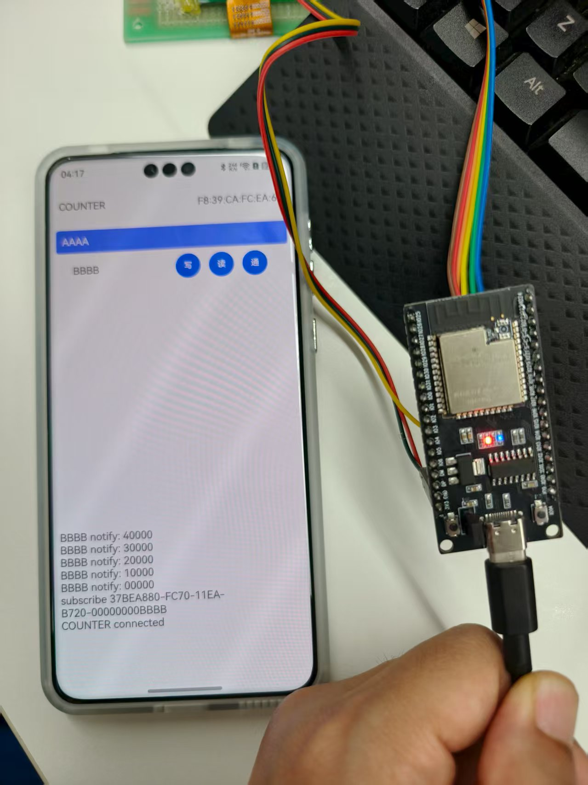
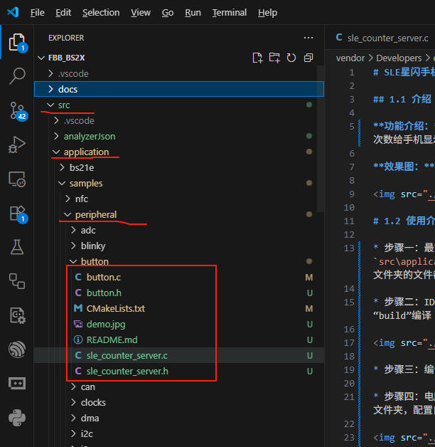
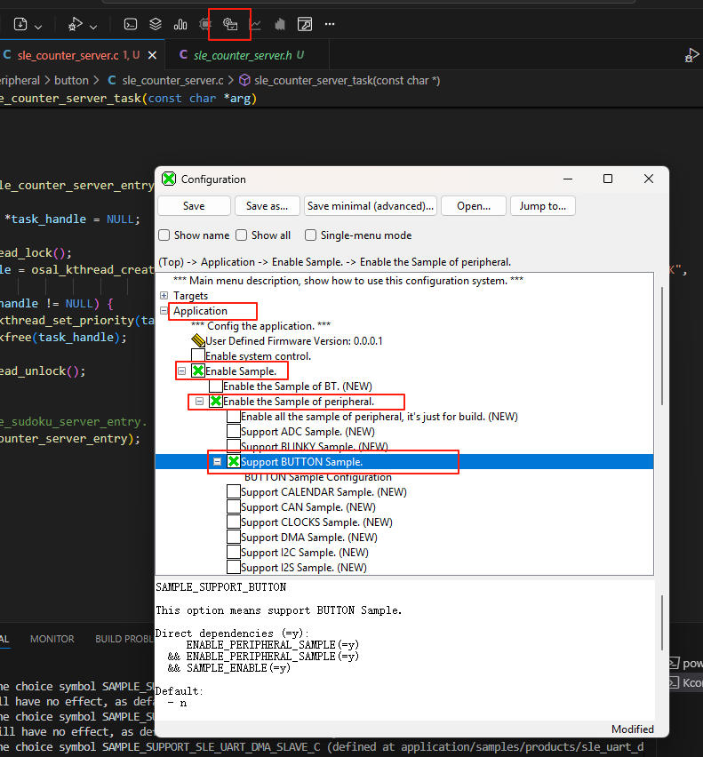
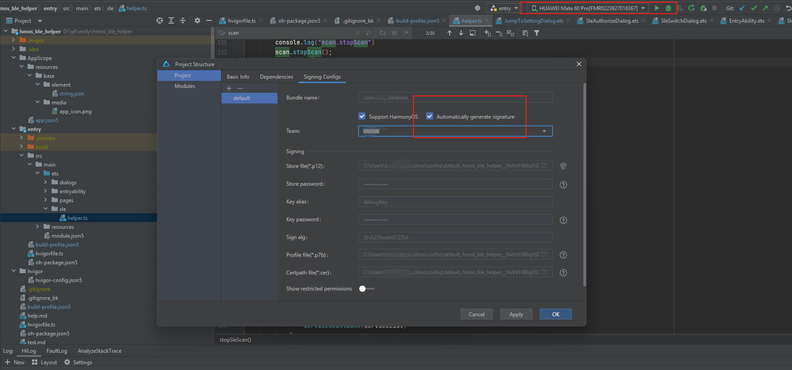
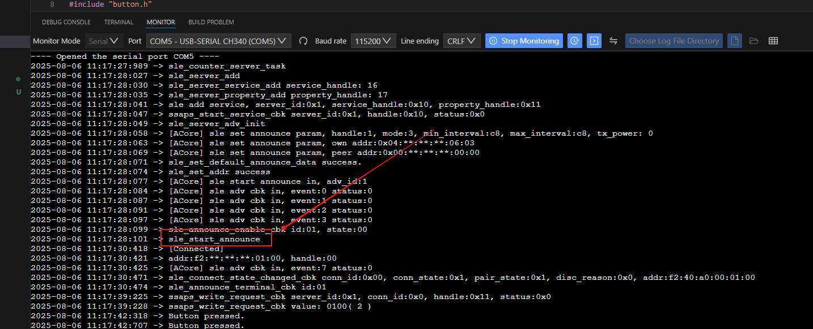
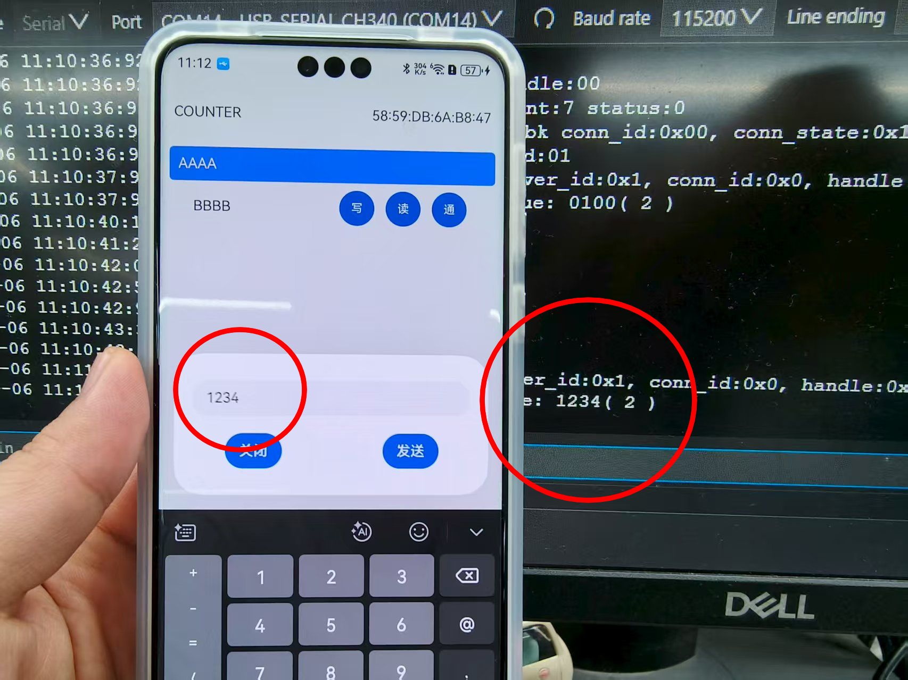
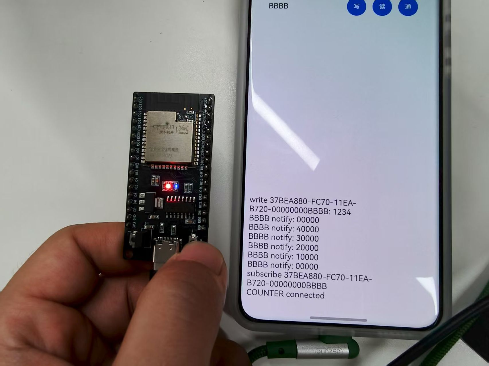

# SLE星闪手机通讯范例

本范例介绍了如何使用BS21开发板的星闪功能和星闪手机进行连接，通过写入和订阅属性值实现手机和开发板的通讯，从而为各种创意应用提供了无限可能，尽享万物互联新世界。

## 功能介绍

手机搜索连接开发板，订阅属性值通知后，开发板按动开关可以上报按动次数给手机显示，手机可以通过写入功能把数值发送给开发板

**效果图：** 

## 相关测试信息

| 项目 | 版本 |
| --- | --- |
| 开发板 | HH-D03 |
| 开发板SDK | 1.0.16(2025年7月28日 commitID 06262d6f) |
| 手机 | Mate60Pro(ALN-AL00) |
| 手机系统 | HarmonyOS 6.0 DB(6.0.0.39) |
| DevEco Studio版本 | 5.1.1 Release |
| DevEco Studio编译SDK | 5.0.1(API 13) |

## 技术要点

- 在鸿蒙API 13的时候公开了手机的星闪接口，我在WS63测试过是可以的，但是在API 17的时候，星闪扫描的功能似乎被修改了，本案例基于现有版本进行测试，请认真核对各种开发工具的版本号

- SLE的广播规范和BLE广播规范有关键性差异，具体请看源码

- 只是通过SLE抓包分析了广播规范完成了项目，不排除后续星闪API会有其他变化，请以最新的API为准

## 使用介绍

* 步骤一：最简单的测试步骤，在SDK的`src\application\samples\peripheral\button`文件夹里面的东西删除，把`board`文件夹的文件都拷贝进去，本案例已经包含了CMake文件

* 步骤二：IDE界面点击`Kconfig`配置功能，打开`samples`和`button`，保存后，点击“build”编译

* 步骤三：编译完毕烧录到开发板上即可

* 步骤四：电脑上安装鸿蒙开发环境，这里不作介绍，用`DevEco Studio`打开`phone`文件夹，配置自动签名就就可以安装到手机上

* 步骤五：开发板上电并打开终端日志，5秒后开发板开始星闪广播，手机上打开应用，点击扫描就可以搜到开发板，点击COUNTER进行连接

* 步骤六：连接成功后，通过写入属性，开发板的日志可以看到收到写入请求

* 步骤七：手机上订阅开发板的BBBB属性，开发板按动开关，手机上可以看到属性变化的通知

